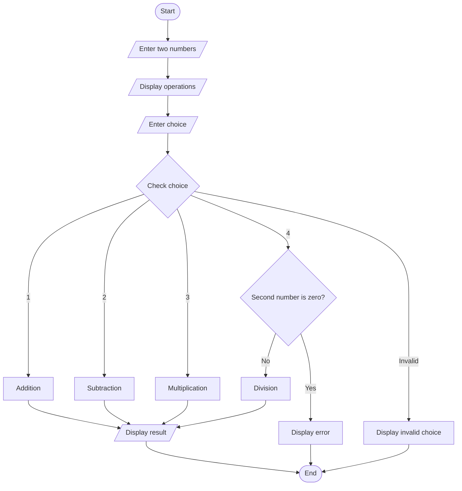

# 🧮 Python Calculator

## 1. Project Description
This is a simple Python Calculator project that performs basic arithmetic operations using Python.

## 2. Objectives
- To understand Python programming.
- To perform arithmetic operations.
- To understand conditional statements.
- To learn user input and output.

## 3. Technologies Used
- Python 3
- Visual Studio Code
- Markdown

## 4. Features
1. Addition
2. Subtraction
3. Multiplication
4. Division
5. Division by zero error handling

## 5. Algorithm
1. Start the program.
2. Enter two numbers.
3. Display the available operations.
4. Enter the operation choice.
5. Check the choice.
6. Perform the selected arithmetic operation.
7. If division is selected, check whether the second number is zero.
8. Display the result or error message.
9. Stop the program.

## 6. Flowchart



## 7. Source Code
The Python program is available in `calculator.py`.

## 8. How to Run
1. Install Python 3.
2. Open the project folder in VS Code.
3. Open the terminal.
4. Run the following command:

```bash
python calculator.py
```

## 9. Sample Output

```text
===== SIMPLE CALCULATOR =====
Enter first number: 20
Enter second number: 10

Choose an operation:
1. Addition
2. Subtraction
3. Multiplication
4. Division

Enter your choice (1-4): 1
Result: 30.0
```

## 10. Conclusion
This project helps beginners understand basic Python programming, arithmetic operations and conditional statements.

---

**Created by:** Mrudhula Varnakavi


